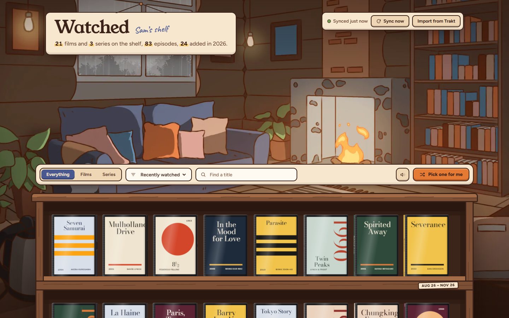
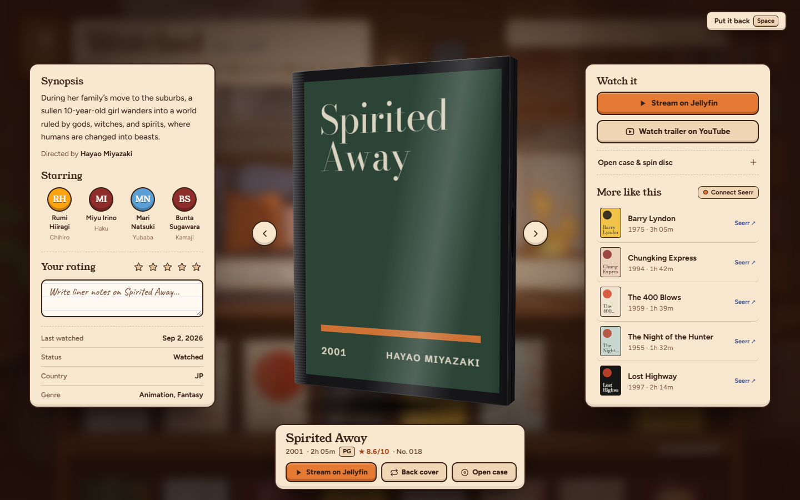
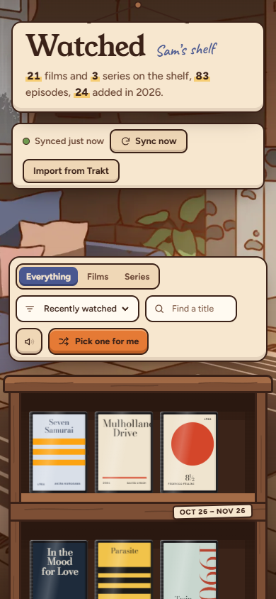

# Watched

**Everything you've watched on Jellyfin, as a shelf of cases in a cozy cabin.** Self-hosted, no accounts.

[](https://github.com/Dev-APkash/watched/actions/workflows/ci.yml)
[](https://github.com/Dev-APkash/watched/releases)
[](LICENSE)



<sub>The built-in sample shelf. Covers are generated, not real artwork.</sub>

Watched reads the watch history that's already in your Jellyfin server and puts it on a bookcase. Every movie and show you've watched becomes a case on the shelf. Pull one off to turn it over in 3D, read the back cover, open it, spin the disc, rate it and write liner notes. Then stream it in Jellyfin. It runs as one small container next to Jellyfin.

> **Two editions.** This is **Watched 2**, the full shelf. Looking for the tiny poster wall? **[Watched 1 (lite)](https://github.com/Dev-APkash/watched/tree/v1)** is still maintained as the lightweight edition: `ghcr.io/dev-apkash/watched:1`. See [Versions](#versions).

## Why Watched?

### No accounts, no trackers

Most "what have I watched" tools need you to sign up for a tracking service, connect your media server to it, and hand your viewing history to a third party. Watched doesn't.

- **Your history stays on your server.** Jellyfin already records what you've watched; Watched just shows it. There's nothing to sign up for and nothing to scrobble.
- **No telemetry, analytics or phoning home.** Watched talks only to your Jellyfin server, plus Trakt *only* if you use the optional import.
- **Your browser loads nothing from the internet.** Fonts, artwork and posters are all served by Watched itself. No CDNs, trackers or third-party scripts, so your browser never contacts Jellyfin and your API key never leaves the server.
- **Ratings and liner notes stay on your server.** They're saved in Watched's own data folder, so every browser you use sees them, and they're never sent anywhere else.

### Still small

| | |
|---|---|
| Image download | ~6 MB (multi-arch: `amd64`, `arm64`, so Raspberry Pi works) |
| Memory at idle | a few MB |
| Dependencies | none: Go standard library only, one static binary |
| Database | none: one JSON file |
| Frontend | one server-rendered page with plain CSS 3D and JavaScript, no framework or build step |

The container runs as an unprivileged user on a [distroless](https://github.com/GoogleContainerTools/distroless) base image, which has no shell or package manager.

## Features

- **A shelf of cases.** Every watched movie and show stands on a wooden bookcase in an animated, illustrated log cabin: rain on the window, the fire going, steam off the kettle. Shelves are labelled by when you watched what's on them.
- **Pick up any case.** It comes off the shelf in 3D. Drag to spin it, scroll to turn it, and press **B** to flip to the back cover with the synopsis, watch facts, episode progress and a barcode.
- **Open it up.** Double-click the case or press **O** to swing the lid open, read the liner notes inside, and pop the disc out to spin it. Sounds are synthesized in the browser (off by default).
- **Rate and annotate.** Give a title stars and write liner notes. Both stay in sync between the side panel and the case itself, and they're saved on your server, so they follow you to any browser.
- **Back it up.** **Backup** downloads the whole shelf with your ratings and notes as JSON, or as a CSV for spreadsheets, and restores ratings and notes from a JSON backup.
- **Watch it.** **Stream on Jellyfin** opens the title in your Jellyfin. There's a trailer search link too.
- **More like this.** Recommendations link to your [Jellyseerr / Seerr](#jellyseerr--seerr) so you can request them.
- Shows appear once you've watched an episode, with progress like `12 / 24 episodes`, and are marked complete when you've seen them all.
- **Rewatches count.** A film shows how many times you've seen it. A show shows when you started it and how many episode plays were repeats.
- Filter (Everything / Films / Series), sort by recently watched, title or release year, and search instantly. **Pick one for me** pulls a random case.
- Keyboard: `[` and `]` step through the shelf, arrow keys turn the case, `F` / `B` / `S` show the front / back / spine, `O` opens and closes the case, `Space` or `Esc` puts it back.
- Phone and desktop layouts. Respects *reduce motion*: the backdrop becomes a still picture.
- **Hide libraries** you don't want on the shelf (for example adult content or home videos).
- **Coming from Trakt?** Paste your profile link once to bring your old history along.
- Background sync every 30 minutes, plus a **Sync now** button. If Jellyfin is down, it keeps showing the last synced data.

<p>
  
  
</p>

## Quick start

You need three things: your Jellyfin URL, an [API key](#create-a-jellyfin-api-key), and the username whose history you want to show.

### Docker Compose

Create a `.env` file (see [`.env.example`](.env.example)):

```env
JELLYFIN_URL=http://jellyfin:8096
JELLYFIN_API_KEY=your-api-key
JELLYFIN_USER=yourname
```

and a `docker-compose.yml`:

```yaml
services:
  watched:
    image: ghcr.io/dev-apkash/watched:2
    container_name: watched
    restart: unless-stopped
    ports:
      - "8080:8080"
    env_file: .env
    volumes:
      - watched-data:/data

volumes:
  watched-data:
```

```sh
docker compose up -d
```

Open <http://localhost:8080>.

If Jellyfin runs in the same compose file, use its service name in `JELLYFIN_URL` (e.g. `http://jellyfin:8096`). Otherwise see [Docker networking](#watched-cant-reach-jellyfin-docker-networking).

### docker run

```sh
docker run -d --name watched \
  -p 8080:8080 \
  -e JELLYFIN_URL=http://192.168.1.10:8096 \
  -e JELLYFIN_API_KEY=your-api-key \
  -e JELLYFIN_USER=yourname \
  -v watched-data:/data \
  --restart unless-stopped \
  ghcr.io/dev-apkash/watched:2
```

> **Windows PowerShell:** the trailing `\` line continuations are for Linux and macOS shells. In PowerShell, put the whole command on one line or end each line with a backtick (`` ` ``) instead.

### Check your settings

This connects to Jellyfin, prints what it found, and exits:

```sh
docker run --rm --env-file .env ghcr.io/dev-apkash/watched:2 -check
```

```
Connecting to http://192.168.1.10:8096 as "yourname"...
OK
Watched movies: 214
Watched shows:  37 (21 completed)
```

## Create a Jellyfin API key

1. Sign in to Jellyfin as an administrator.
2. Go to **Dashboard → API Keys** (under *Advanced* in older versions).
3. Click **+**, name it `Watched`, and confirm.
4. Copy the key into `JELLYFIN_API_KEY`.

Jellyfin API keys have administrator access, so treat the key like a password. Watched only uses it to *read* users, libraries, items and images.

## Configuration

All configuration is done with environment variables. Outside Docker, Watched also reads a `.env` file in its working directory; real environment variables take precedence.

| Variable | Required | Default | Description |
|---|---|---|---|
| `JELLYFIN_URL` | yes | | Jellyfin's address as seen **from inside the container**, including any base path, e.g. `http://jellyfin:8096` or `https://example.com/jellyfin` |
| `JELLYFIN_API_KEY` | yes | | API key from **Dashboard → API Keys** |
| `JELLYFIN_USER` | yes | | Jellyfin username whose history to show (case-insensitive) |
| `EXCLUDE_LIBRARIES` | no | | Comma-separated library names to leave out, e.g. `Adult,Home Videos` |
| `SEERR_URL` | no | | Your Jellyseerr / Seerr address for "More like this" links, e.g. `http://localhost:5055`. `JELLYSEERR_URL` also works |
| `REFRESH_MINUTES` | no | `30` | How often to sync with Jellyfin in the background |
| `PORT` | no | `8080` | Port the page listens on |
| `TZ` | no | `UTC` | Time zone for displayed dates, e.g. `Europe/Berlin` |
| `TRAKT_CLIENT_ID` | no | built in | Use your own Trakt API app for the import, or `off` to remove the import option |
| `DATA_DIR` | no | `/data` (`data` on Windows) | Where data is stored. Only useful when running outside Docker |

Watched checks its settings on startup. It exits with a clear message if a variable is missing or invalid, Jellyfin rejects the API key, or the user or an excluded library doesn't exist. If Jellyfin is only unreachable, Watched starts anyway, shows the last synced data and keeps retrying.

### Hiding libraries

Set `EXCLUDE_LIBRARIES` to the library names as they appear on Jellyfin's home screen:

```env
EXCLUDE_LIBRARIES=Adult,Home Videos
```

Anything you watched in those libraries is left off the shelf, and its cached posters are deleted. A misspelled name stops Watched with a list of the real library names, so a typo can never quietly show content you meant to hide.

### Jellyseerr / Seerr

Set `SEERR_URL` and every "More like this" recommendation opens its page in your Jellyseerr or Seerr, ready to request. You can also set or change the address from the page itself (**Connect Seerr** in the side panel); that choice is saved in your browser.

### Your own backdrop

The cabin artwork lives in `assets/`. To use a different scene, put your own `cabin.webp` (animated is fine) and `cabin-still.jpg` (shown when *reduce motion* is on) next to the binary in an `assets/` folder, or mount them into the container:

```yaml
    volumes:
      - watched-data:/data
      - ./my-scene.webp:/assets/cabin.webp:ro
      - ./my-scene.jpg:/assets/cabin-still.jpg:ro
```

## Coming from Trakt

If you used [Trakt](https://trakt.tv) to track what you watched before moving to Jellyfin, you can bring that history over. You don't need a Trakt app, API key or login:

1. On the Watched page, click **Import from Trakt**.
2. Paste your profile link, e.g. `https://trakt.tv/users/yourname`, and click **Import**.

Your Trakt movies and shows join the shelf. A title you watched both in Jellyfin and on Trakt appears once, matched by IMDb, TMDB or TVDB id, with the latest watch date and the episodes from both combined.

- **Your profile must be public** while you import. If it's private, turn off *private* in your Trakt settings, import, then turn it back on.
- **Imports refresh with each sync.** Once you've imported a profile, every background sync and **Sync now** also refreshes it from Trakt while the profile is public. A new import replaces the old one.
- Large histories take a moment: about 2 minutes for a profile with 2,500 titles and 65,000 episode plays.
- To remove an import, delete `trakt.json` from the data volume and restart Watched.

## Your data and privacy

Everything Watched stores on the server lives in the `/data` volume:

| File | What it is |
|---|---|
| `state.json` | The last list synced from Jellyfin |
| `trakt.json` | Your Trakt import, if you made one |
| `marks.json` | Your star ratings and liner notes |
| `posters/` | One small image per title. Posters of titles you no longer have are deleted on each sync |

Your sound setting and Seerr address are stored in your browser's local storage (keys starting with `watched.`), so they're per browser. Ratings and notes saved by an older version in local storage move to `marks.json` the first time you open the page.

### Backups

Open **Backup** on the page:

- **Download backup** saves `watched-<date>.json` with every title on the shelf (watch dates, episodes, external ids) plus your ratings and notes.
- **Spreadsheet (CSV)** saves the same list as a CSV file.
- **Restore…** reads a JSON backup and puts its ratings and notes back. Titles are matched by their Jellyfin id, or by IMDb, TMDB or TVDB id if the id has changed (for example after rebuilding your Jellyfin server). A restore replaces the rating and note of each title in the backup and leaves all the others alone. Watch history always comes from Jellyfin and Trakt, so a restore doesn't change it.

To back up from a script, fetch `/export.json` or copy `marks.json` from the data volume.

Network requests Watched makes:

- **Your Jellyfin server**: on startup, every `REFRESH_MINUTES`, and when you click **Sync now**
- **Trakt** (`api.trakt.tv` and its image CDN): while an import you started is running, and on syncs after you've imported a profile

That's all. There's no telemetry or update check. The page itself only loads from Watched; the trailer and Seerr links open other sites only when you click them.

The page has no login, which suits a home network. If you expose it to the internet, put it behind your reverse proxy's authentication. Anyone who can open the page can also change ratings and notes, restore a backup, and start a Trakt import; set `TRAKT_CLIENT_ID=off` if you don't want that.

The container runs as user `65532`. Named volumes just work. If you bind-mount a folder instead, make it writable for that user: `sudo chown 65532:65532 ./data`.

## Versions

Releases follow [semantic versioning](https://semver.org) and are published as `ghcr.io/dev-apkash/watched:<version>`.

| Edition | Image | Source | What it is |
|---|---|---|---|
| **Watched 2** (current) | `:2`, `:latest` | [`main`](https://github.com/Dev-APkash/watched) | The cabin shelf with 3D cases, ratings, notes and Seerr links |
| **Watched 1 (lite)** | `:1` | [`v1` branch](https://github.com/Dev-APkash/watched/tree/v1) | The original tiny poster wall: ~5 MB image, ~40 lines of JavaScript, no artwork |

Both read the same `/data` volume, so you can switch between them in either direction. Pin `:2` or `:1` to stay on an edition; `:latest` follows the current one.

## Endpoints

| Path | Description |
|---|---|
| `GET /` | The page |
| `GET /api/items` | The merged watch list as JSON |
| `GET /posters/{name}` | Cached poster images |
| `GET /assets/{name}` | Backdrop artwork and fonts |
| `POST /refresh` | Sync with Jellyfin now |
| `POST /import-trakt` | Import a public Trakt profile (form field `profile`) |
| `POST /api/marks` | Save ratings and notes: `{"<item id>": {"rating": 4, "note": "…"}}`. A rating of `0` or an empty note clears it |
| `GET /export.json` | Download a backup of the shelf with ratings and notes |
| `GET /export.csv` | The same as a CSV file |
| `POST /api/marks/restore` | Restore ratings and notes from a backup file (the JSON body) |
| `GET /health` | Returns `ok`; used by the image's built-in Docker `HEALTHCHECK` |

## Build from source

Requires [Go](https://go.dev/dl/) 1.25 or newer. There are no third-party dependencies.

```sh
git clone https://github.com/Dev-APkash/watched.git
cd watched
go test ./...
go build -o watched .

JELLYFIN_URL=http://localhost:8096 JELLYFIN_API_KEY=... JELLYFIN_USER=yourname DATA_DIR=./data ./watched
```

Or build the image: `docker build -t watched .`

To build the lite edition, check out the `v1` branch first.

**Why Go?** It compiles to a single static binary with an HTTP server, HTML templates and JSON built in, so the image is just that binary (with the page, fonts and artwork embedded in it) on a distroless base.

## FAQ / troubleshooting

### "… does not look like a Jellyfin server"

Watched reached something at that address, but not the Jellyfin API. Check:

- the port (Jellyfin's default is `8096` for HTTP, `8920` for HTTPS)
- the base path: if you open Jellyfin at `https://example.com/jellyfin`, that whole URL is your `JELLYFIN_URL`
- that you used the server address, not a page inside the web UI (no `/web/#/...`)

### "Jellyfin rejected the API key (HTTP 401)"

The key is wrong or was deleted. Create a new one under **Dashboard → API Keys** and copy it exactly, with no quotes or spaces. A user's password or session token won't work; it must be an API key.

### "user … not found" or "library … not found"

`JELLYFIN_USER` must be a Jellyfin *username* (**Dashboard → Users**). `EXCLUDE_LIBRARIES` must use library names as that user sees them. The error message lists the names Jellyfin knows about, so copy one exactly.

### Watched can't reach Jellyfin (Docker networking)

"cannot reach Jellyfin" means the container couldn't connect at all. Inside a container, `localhost` means *the container itself*, not your server. Use one of these:

- **Same compose file or Docker network:** the service or container name, e.g. `http://jellyfin:8096`
- **Different compose projects:** put both on a shared network (`docker network create media`, add it to both services) and use the container name
- **Jellyfin installed on the host, or using `network_mode: host`:** the host's LAN IP, e.g. `http://192.168.1.10:8096`. On Docker Desktop, `http://host.docker.internal:8096` also works; on Linux add `extra_hosts: ["host.docker.internal:host-gateway"]` to use that name.

Run the [`-check`](#check-your-settings) command to test. Add `--network <name>` if Jellyfin is on a custom Docker network.

### "data directory is not writable"

You bind-mounted a folder the container user can't write to. Run `sudo chown 65532:65532 <folder>` or use a named volume.

### Dates are off by a few hours

Set `TZ` to your time zone, e.g. `TZ=America/New_York`.

### A show says 3 / 10 episodes but I've seen more

Watched counts episodes Jellyfin has marked as *played* for that user. Jellyfin counts an episode you stopped partway through (before about 90%) as unplayed. Missing (virtual) episodes and, for Trakt imports, specials are not counted.

### A show's "Started" date is later than I remember

Jellyfin keeps only the *latest* time you played each episode, so if you rewatched the first episodes, the start date moves to that rewatch. Trakt keeps every play, so a Trakt import fixes it: Watched uses the earliest date from either.

### Rewatch counts look low, or a film says "Once" when I've seen it more

Jellyfin counts plays it saw itself, and a film marked as watched by hand counts as one. If you also used Trakt, Watched shows the higher of the two counts. It doesn't add them, because Trakt often holds the same plays scrobbled from Jellyfin.

### A title appears twice after a Trakt import

Titles are matched by IMDb, TMDB and TVDB ids. If Jellyfin couldn't identify a movie or show, there's nothing to match on. Fix the item in Jellyfin with **Identify**, then click **Sync now**.

### Trakt import: "profile is private" or "user not found"

Use your *profile* link (`https://trakt.tv/users/<name>`), not a movie or list page, and make sure the profile is public while importing.

### My ratings and notes disappeared

They live in `marks.json` in the data volume. If the volume was deleted or replaced, restore a backup from **Backup → Restore…**. Since version 2.1 ratings and notes are kept on the server. Older versions saved them in the browser, and they move to the server the next time you open the page in that browser.

### "marks.json is unreadable"

Watched won't start with a damaged `marks.json`, so it can't overwrite your notes with an empty file. Fix the file, or move it aside and restore a backup.

### The page feels heavy on an old device

Turn on your system's *reduce motion* setting to swap the animated backdrop for a still picture, or run [Watched 1 (lite)](https://github.com/Dev-APkash/watched/tree/v1) against the same data.

### Can it run behind a reverse proxy on a sub-path?

Yes. All links on the page are relative, so proxying `https://example.com/watched/` to Watched works without extra configuration.

## Credits

- **Cabin backdrop:** illustration by **alvirtual**, used with credit: [ArtStation](https://alvirtual8.artstation.com) · [Instagram](https://www.instagram.com/alvirtual) · [X / Twitter](https://twitter.com/alvirtual00). The artwork belongs to the artist and is **not** covered by this project's MIT license. Please don't reuse it outside Watched without the artist's permission.
- **Fonts:** Young Serif, Figtree, Caveat, Bodoni Moda, Azeret Mono and Schibsted Grotesk, all under the SIL Open Font License 1.1 ([`assets/OFL.txt`](assets/OFL.txt)).

## For maintainers

Pushing a tag like `v2.1.0` makes GitHub Actions run the tests, build `linux/amd64` and `linux/arm64` images, and push them to GHCR as `2.1.0`, `2.1`, `2` and `latest`. Pull requests and pushes to `main` run the tests and a build without publishing.

Lite-edition fixes go on the `v1` branch and are tagged `v1.0.x`. Note that the workflow also moves `latest` on those tags, so re-tag the newest v2 release afterwards (or adjust the workflow) to keep `latest` on Watched 2.

The Trakt import uses this project's Trakt API app. Its client ID in [`trakt.go`](trakt.go) is public by design; the app's client secret isn't used and must never be committed.

## License

Code: [MIT](LICENSE). The cabin artwork in `assets/cabin.webp` and `assets/cabin-still.jpg` is by alvirtual and excluded from the MIT license; see [Credits](#credits).
