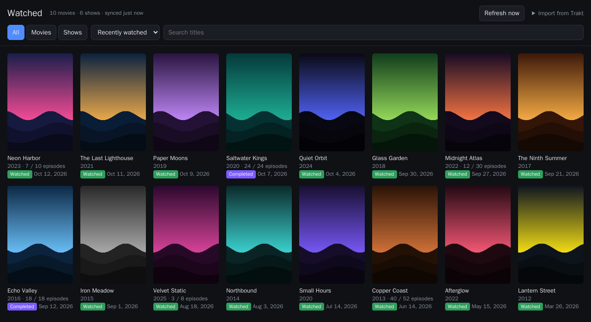
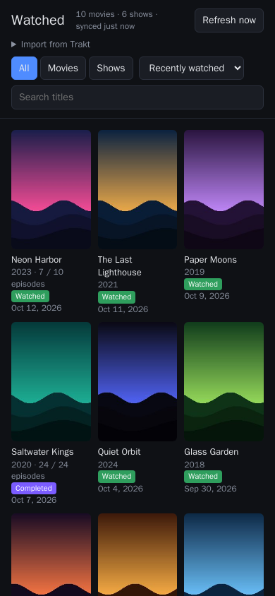

# Watched

**Everything you've watched on Jellyfin, as one poster wall.** Tiny, self-hosted, no accounts.

[](https://github.com/Dev-APkash/watched/actions/workflows/ci.yml)
[](https://github.com/Dev-APkash/watched/releases)
[](LICENSE)



<sub>Demo data. Titles and artwork are made up.</sub>

Watched reads the watch history that's already in your Jellyfin server and turns it into a single page. You get a poster, title, year and **Watched** badge for every movie, the date you last watched it, and episode progress for every show you've started. It runs as one small container next to Jellyfin.

## Why Watched?

### No accounts, no trackers

Most "what have I watched" tools need you to sign up for a tracking service, connect your media server to it, and hand your viewing history to a third party. Watched doesn't.

- **Your history stays on your server.** Jellyfin already records what you've watched; Watched just shows it. There's nothing to sign up for and nothing to scrobble.
- **No telemetry, analytics or phoning home.** Watched talks only to your Jellyfin server, plus Trakt *only* if you click the optional one-time import.
- **Your browser loads nothing from the internet.** No CDNs, web fonts, trackers or third-party scripts. Posters are cached on your server and served by Watched itself, so your browser never contacts Jellyfin and your API key never leaves the server.

### Lightweight

| | |
|---|---|
| Image download | ~5 MB (multi-arch: `amd64`, `arm64`, so Raspberry Pi works) |
| Memory at idle | ~5 MB |
| Dependencies | none: Go standard library only, one static binary |
| Database | none: one JSON file |
| Frontend | one server-rendered page, ~40 lines of plain JavaScript, no framework or build step |
| Posters | ~6 KB each (200 px JPEG), lazy-loaded |

The container runs as an unprivileged user on a [distroless](https://github.com/GoogleContainerTools/distroless) base image, which has no shell or package manager.

## Features

- Poster grid of every watched movie and show, sorted by most recently watched or A–Z
- Shows appear once you've watched an episode, with progress like `12 / 24 episodes`, and are marked **Completed** when you've seen them all
- Filter (All / Movies / Shows) and instant title search
- Phone and desktop layouts, dark theme
- **Hide libraries** you don't want on the wall (for example adult content or home videos)
- **Coming from Trakt?** Paste your profile link once to bring your old history along
- Background sync every 30 minutes, plus a **Refresh now** button
- If Jellyfin is down, keeps showing the last synced data



## Quick start

You need three things: your Jellyfin URL, an [API key](#create-a-jellyfin-api-key), and the username whose history you want to show.

### Docker Compose

Create a `.env` file (see [`.env.example`](.env.example)):

```env
JELLYFIN_URL=http://jellyfin:8096
JELLYFIN_API_KEY=your-api-key
JELLYFIN_USER=yourname
```

and a `docker-compose.yml`:

```yaml
services:
  watched:
    image: ghcr.io/dev-apkash/watched:1
    container_name: watched
    restart: unless-stopped
    ports:
      - "8080:8080"
    env_file: .env
    volumes:
      - watched-data:/data

volumes:
  watched-data:
```

```sh
docker compose up -d
```

Open <http://localhost:8080>.

If Jellyfin runs in the same compose file, use its service name in `JELLYFIN_URL` (e.g. `http://jellyfin:8096`). Otherwise see [Docker networking](#watched-cant-reach-jellyfin-docker-networking).

### docker run

```sh
docker run -d --name watched \
  -p 8080:8080 \
  -e JELLYFIN_URL=http://192.168.1.10:8096 \
  -e JELLYFIN_API_KEY=your-api-key \
  -e JELLYFIN_USER=yourname \
  -v watched-data:/data \
  --restart unless-stopped \
  ghcr.io/dev-apkash/watched:1
```

> **Windows PowerShell:** the trailing `\` line continuations are for Linux and macOS shells. In PowerShell, put the whole command on one line or end each line with a backtick (`` ` ``) instead.

### Check your settings

This connects to Jellyfin, prints what it found, and exits:

```sh
docker run --rm --env-file .env ghcr.io/dev-apkash/watched:1 -check
```

```
Connecting to http://192.168.1.10:8096 as "yourname"...
OK
Watched movies: 214
Watched shows:  37 (21 completed)
```

## Create a Jellyfin API key

1. Sign in to Jellyfin as an administrator.
2. Go to **Dashboard → API Keys** (under *Advanced* in older versions).
3. Click **+**, name it `Watched`, and confirm.
4. Copy the key into `JELLYFIN_API_KEY`.

Jellyfin API keys have administrator access, so treat the key like a password. Watched only uses it to *read* users, libraries, items and images.

## Configuration

All configuration is done with environment variables.

| Variable | Required | Default | Description |
|---|---|---|---|
| `JELLYFIN_URL` | yes | | Jellyfin's address as seen **from inside the container**, including any base path, e.g. `http://jellyfin:8096` or `https://example.com/jellyfin` |
| `JELLYFIN_API_KEY` | yes | | API key from **Dashboard → API Keys** |
| `JELLYFIN_USER` | yes | | Jellyfin username whose history to show (case-insensitive) |
| `EXCLUDE_LIBRARIES` | no | | Comma-separated library names to leave out, e.g. `Adult,Home Videos` |
| `REFRESH_MINUTES` | no | `30` | How often to sync with Jellyfin in the background |
| `PORT` | no | `8080` | Port the page listens on |
| `TZ` | no | `UTC` | Time zone for displayed dates, e.g. `Europe/Berlin` |
| `TRAKT_CLIENT_ID` | no | built in | Use your own Trakt API app for the import, or `off` to remove the import option |
| `DATA_DIR` | no | `/data` | Where data is stored. Only useful when running outside Docker |

Watched checks its settings on startup. It exits with a clear message if a variable is missing or invalid, Jellyfin rejects the API key, or the user or an excluded library doesn't exist. If Jellyfin is only unreachable, Watched starts anyway, shows the last synced data and keeps retrying.

### Hiding libraries

Set `EXCLUDE_LIBRARIES` to the library names as they appear on Jellyfin's home screen:

```env
EXCLUDE_LIBRARIES=Adult,Home Videos
```

Anything you watched in those libraries is left off the page, and its cached posters are deleted. A misspelled name stops Watched with a list of the real library names, so a typo can never quietly show content you meant to hide.

## Coming from Trakt

If you used [Trakt](https://trakt.tv) to track what you watched before moving to Jellyfin, you can bring that history over. You don't need a Trakt app, API key or login:

1. On the Watched page, click **Import from Trakt**.
2. Paste your profile link, e.g. `https://trakt.tv/users/yourname`, and click **Import**.

Your Trakt movies and shows join the grid. A title you watched both in Jellyfin and on Trakt appears once, matched by IMDb, TMDB or TVDB id, with the latest watch date and the episodes from both combined.

- **Your profile must be public** while you import. If it's private, turn off *private* in your Trakt settings, import, then turn it back on.
- **It's a one-time snapshot, not a sync.** After switching to Jellyfin, you don't need Trakt any more. You can import again at any time; a new import replaces the old one.
- Large histories take a moment: about 2 minutes for a profile with 2,500 titles and 65,000 episode plays.
- To remove an import, delete `trakt.json` from the data volume and restart Watched.

## Your data and privacy

Everything Watched stores lives in the `/data` volume:

| File | What it is |
|---|---|
| `state.json` | The last list synced from Jellyfin |
| `trakt.json` | Your Trakt import, if you made one |
| `posters/` | One small image per title. Posters of titles you no longer have are deleted on each sync |

Network requests Watched makes:

- **Your Jellyfin server**: on startup, every `REFRESH_MINUTES`, and when you click **Refresh now**
- **Trakt** (`api.trakt.tv` and its image CDN): only while an import you started is running

That's all. There's no telemetry or update check.

The page has no login, which suits a home network. If you expose it to the internet, put it behind your reverse proxy's authentication. Anyone who can open the page can also start a Trakt import; set `TRAKT_CLIENT_ID=off` if you don't want that.

The container runs as user `65532`. Named volumes just work. If you bind-mount a folder instead, make it writable for that user: `sudo chown 65532:65532 ./data`.

## Versions

Releases follow [semantic versioning](https://semver.org). Each release is published as `ghcr.io/dev-apkash/watched:<version>`, plus `:1` (latest 1.x.x) and `:latest`.

- **Version 1 is stable.** Pin `:1` to get fixes without surprises.
- New features will ship in **version 2**. `:latest` will move to it, `:1` won't.

## Endpoints

| Path | Description |
|---|---|
| `GET /` | The page |
| `POST /refresh` | Sync with Jellyfin now |
| `POST /import-trakt` | Import a public Trakt profile (form field `profile`) |
| `GET /health` | Returns `ok`; used by the image's built-in Docker `HEALTHCHECK` |

## Build from source

Requires [Go](https://go.dev/dl/) 1.25 or newer. There are no third-party dependencies.

```sh
git clone https://github.com/Dev-APkash/watched.git
cd watched
go test ./...
go build -o watched .

JELLYFIN_URL=http://localhost:8096 JELLYFIN_API_KEY=... JELLYFIN_USER=yourname DATA_DIR=./data ./watched
```

Or build the image: `docker build -t watched .`

**Why Go?** It compiles to a single static binary with an HTTP server, HTML templates and JSON built in, so the image is just that binary (with the page embedded in it) on a distroless base.

## FAQ / troubleshooting

### "… does not look like a Jellyfin server"

Watched reached something at that address, but not the Jellyfin API. Check:

- the port (Jellyfin's default is `8096` for HTTP, `8920` for HTTPS)
- the base path: if you open Jellyfin at `https://example.com/jellyfin`, that whole URL is your `JELLYFIN_URL`
- that you used the server address, not a page inside the web UI (no `/web/#/...`)

### "Jellyfin rejected the API key (HTTP 401)"

The key is wrong or was deleted. Create a new one under **Dashboard → API Keys** and copy it exactly, with no quotes or spaces. A user's password or session token won't work; it must be an API key.

### "user … not found" or "library … not found"

`JELLYFIN_USER` must be a Jellyfin *username* (**Dashboard → Users**). `EXCLUDE_LIBRARIES` must use library names as that user sees them. The error message lists the names Jellyfin knows about, so copy one exactly.

### Watched can't reach Jellyfin (Docker networking)

"cannot reach Jellyfin" means the container couldn't connect at all. Inside a container, `localhost` means *the container itself*, not your server. Use one of these:

- **Same compose file or Docker network:** the service or container name, e.g. `http://jellyfin:8096`
- **Different compose projects:** put both on a shared network (`docker network create media`, add it to both services) and use the container name
- **Jellyfin installed on the host, or using `network_mode: host`:** the host's LAN IP, e.g. `http://192.168.1.10:8096`. On Docker Desktop, `http://host.docker.internal:8096` also works; on Linux add `extra_hosts: ["host.docker.internal:host-gateway"]` to use that name.

Run the [`-check`](#check-your-settings) command to test. Add `--network <name>` if Jellyfin is on a custom Docker network.

### "data directory is not writable"

You bind-mounted a folder the container user can't write to. Run `sudo chown 65532:65532 <folder>` or use a named volume.

### Dates are off by a few hours

Set `TZ` to your time zone, e.g. `TZ=America/New_York`.

### A show says 3 / 10 episodes but I've seen more

Watched counts episodes Jellyfin has marked as *played* for that user. Jellyfin counts an episode you stopped partway through (before about 90%) as unplayed. Missing (virtual) episodes and, for Trakt imports, specials are not counted.

### A title appears twice after a Trakt import

Titles are matched by IMDb, TMDB and TVDB ids. If Jellyfin couldn't identify a movie or show, there's nothing to match on. Fix the item in Jellyfin with **Identify**, then click **Refresh now**.

### Trakt import: "profile is private" or "user not found"

Use your *profile* link (`https://trakt.tv/users/<name>`), not a movie or list page, and make sure the profile is public while importing.

### Can it run behind a reverse proxy on a sub-path?

Yes. All links on the page are relative, so proxying `https://example.com/watched/` to Watched works without extra configuration.

## For maintainers

Pushing a tag like `v1.2.3` makes GitHub Actions run the tests, build `linux/amd64` and `linux/arm64` images, and push them to GHCR as `1.2.3`, `1.2`, `1` and `latest`. Pull requests and pushes to `main` run the tests and a build without publishing.

The Trakt import uses this project's Trakt API app. Its client ID in [`trakt.go`](trakt.go) is public by design; the app's client secret isn't used and must never be committed.

## License

[MIT](LICENSE)
